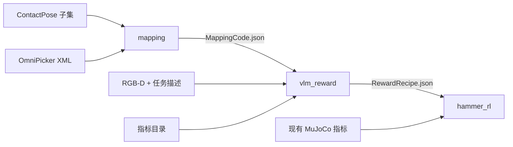

# Codex 本地项目改造操作说明：免训练人手—OmniPicker 映射与 VLM 奖励生成

> **目标仓库**：`hammering-task`（以 Codex 打开的本地工作树为准）  
> **预期新增顶层功能包**：`mapping/`、`vlm_reward/`  
> **主要依赖数据**：[ContactPose](https://github.com/facebookresearch/ContactPose)  
> **夹爪**：`assets/grippers/omnipicker/ominipicker.xml`  
> **现有 RL**：`hammer_rl/`，保留单步完整 6D 抓取决策、固定工具操作轨迹、PPO 和 SGS  
> **交付形式**：修改本地代码、生成离线映射文件和奖励配置，并提交简明的修改清单及运行命令。本文档本身不要求创建 PR。

## 0. Codex 必须遵守的执行指令

你现在要在**已有本地仓库**上实施最小范围改造，不要重新搭建一个机器人学习项目。开始前先阅读本地的 `AGENTS.md`（若存在）、现有 `hammer_rl/README.md`，以及相关源文件；**本地文件优先于本文描述和线上仓库**。只对实现目标必需的文件动手，不覆盖用户已有本地改动。

**不可违反的要求：**

1. 将此前方案中的 `human_gripper_mapping/` **统一更名为 `mapping/`**。如果本地尚未创建该目录，直接建立 `mapping/`；不要同时保留两个同义功能包。
2. **不得训练 Encoder。** `mapping` 是确定性的、可解释的几何/接触编码器，不是神经网络；不得新增 Encoder 网络、伪配对数据训练、优化器、loss、蒸馏或相关权重文件。
3. `mapping` 只负责从 ContactPose 和 OmniPicker 提取及转换功能抓取信息，输出 `MappingCode`；**其唯一业务消费者是 `vlm_reward`**。不要直接将编码向量拼接到 RL Actor/Critic 的 observation。
4. `vlm_reward` 只负责处理 RGB-D 和文字任务描述、读取 `MappingCode`、调用 VLM API，以及生成结构化 `RewardRecipe`。**不参与 PPO step / MuJoCo 每个物理子步**。
5. `hammer_rl` 只读取 `RewardRecipe`、执行已有物理奖励算子和新增的少量必要奖励项。保持现有单步 6D 动作语义、PPO、SGS、Teacher/Student 流程，不重新引入 AnyGrasp 在线候选或手内重抓取。
6. **最小修改、不重复造轮子。** 优先复用 `generation/enclosure.py`、现有接触传感器、`DirectGraspAction.values`、`hammer_rl/mdp/rewards.py`、ContactPose 官方加载器、MuJoCo，以及已安装的依赖。
7. **不添加防御性代码或额外安全检查。** 不新增空泛的 `try/except`、回退路径、自动重试、冗余 `if` 判空、输入合法性断言、额外权限/安全过滤器或异常兼容层。输入/输出格式由明确的数据契约和官方 SDK 的结构化输出保障。不要将必要的确定性几何计算、算法分支或功能验收与“防御性代码”混为一谈。
8. 不复制整套 PPO、场景生成器、接触/包络打分实现；不引入额外抓取检测框架、深度大模型、向量数据库、消息队列、Web 服务或复杂插件机制。
9. 不为优化工程结构而大规模重构现有项目。不修改无关模块；不得在现有 `assets`、`generation` 中重复创建已有功能。
10. 不虚构尚不存在的数据、实验结果或扫帚/切割物理指标。对需要新增任务场景才能计算的指标，实际实现后才作为可用奖励算子注册。

**任务完成标准**：能从所需 ContactPose 子集及 OmniPicker 模型离线导出真实 `MappingCode`，能对指定场景的 RGB-D 和文字描述调用 VLM 生成 `RewardRecipe`，能在现有锤击训练入口通过开关读取该配置并计算真实物理奖励；清扫/切割按第 9 节扩展，必须使用各自真实可计算的物理指标。

---

## 1. 先核对本地仓库，确定最小改动点

只做一次定向阅读，重点检查：

| 路径 | 核对内容 | 原则 |
|---|---|---|
| `assets/grippers/omnipicker/ominipicker.xml` | 指尖 Site、碰撞 Geom、单执行器、对称耦合、被动关节 | 不修改夹爪机构 |
| `assets/scenes/scene.xml` | 相机、OmniPicker 挂载和锤子引用 | 优先沿用 |
| `hammer_rl/mdp/actions.py` | `direct_grasp_pose`、`DirectGraspAction`、`values`、`observe_substep` | 保留单步动作和评分缓存 |
| `hammer_rl/mdp/rewards.py` | 现有 `score(env, name)` | 在这里组合 Recipe，不重算物理量 |
| `hammer_rl/env_cfg.py` | `RewardTermCfg` 注册和 metrics | 新 Recipe 以可选配置接入 |
| `hammer_rl/mdp/resets.py` | `initialize_task`、`scene_id`、reset bank | 复用缓存和场景索引 |
| `hammer_rl/prepare.py` | 深度图、相机参数、`handle_size`、场景银行 | 仅补充必要的 RGB/场景描述导出 |
| `hammer_rl/train.py` | CLI、环境构造和日志 | 只增加可选 Recipe 文件参数 |
| `generation/enclosure.py` | 现有包络和座靠几何评分 | 直接复用 |

已核对的上游仓库在 `hammer_rl/mdp/actions.py` 中使用 `direct_grasp_pose()` 将 6 维动作映射到锤柄局部抓取位置及完整轴角旋转；`observe_substep()` 维护真实接触和敲击指标；`rewards.score()` 读取 `values[name]`。本地若已调整，以本地最新实现为准。

**本次不做**：为了接入映射而修改 PPO 网络结构、observation 维度、AnyGrasp 管线、Teacher/Student 蒸馏方法或现有固定敲击轨迹。

---

## 2. 最终目录结构与文件职责

```text
hammering-task/
├── mapping/                          # 新增：无训练的结构化映射编码
│   ├── __init__.py
│   ├── contactpose_reader.py         # 复用 ContactPose 标注与接触图读取
│   ├── hand_geometry.py              # 手部关键点与局部坐标系
│   ├── contact_encoder.py           # 物体表面接触分布 -> 把手规范化表达
│   ├── omnipicker_adapter.py        # 读取 MuJoCo XML 的机构/接触能力
│   ├── hand_gripper_mapper.py       # 人手闭合轴、接近轴 -> 夹爪对应关系
│   ├── mapping_encoder.py           # 组合并输出 MappingCode
│   ├── export_mapping.py            # 唯一 CLI 入口
│   └── configs/
│       ├── mapping.yaml             # 确定性参数、ContactPose 子集选择
│       └── tool_frames.yaml         # 工具规范坐标、工作端与自由端
│
├── vlm_reward/                       # 新增：VLM 设计与版本化奖励
│   ├── __init__.py
│   ├── api_client.py                 # OpenAI SDK / Responses API
│   ├── rgbd_context.py              # 已有 RGB-D 数据转视觉输入
│   ├── context_builder.py           # 任务、MappingCode、物理指标目录
│   ├── reward_schema.py             # RewardRecipe / 指标描述结构
│   ├── reward_designer.py           # 唯一离线生成 CLI
│   ├── feedback_refiner.py          # 可选：按训练阶段修订 Recipe
│   ├── recipe_store.py              # 保存/读取版本化 JSON
│   ├── prompts/
│   │   ├── reward_design.md
│   │   └── reward_refinement.md
│   └── configs/
│       └── vlm.yaml                 # 模型名称、提示词路径、API 参数
│
├── hammer_rl/                        # 保留现有单步 PPO 主体
│   ├── env_cfg.py                   # 可选读取 RewardRecipe
│   ├── train.py                     # 增加 --reward-recipe
│   └── mdp/
│       ├── actions.py              # 最多新增少量映射匹配评分缓存
│       ├── rewards.py              # 根据 Recipe 汇总现有指标
│       ├── resets.py               # 需要时装载场景 Reward 参数
│       └── ...
│
├── assets/                           # 已有模型；按任务需要新增场景
├── generation/                       # 已有运动/几何工具；仅补齐新任务
├── data/human_grasp/                 # ContactPose 原始子集及输出；不入库大文件
│   ├── source/contactpose/
│   └── processed/
│       ├── hammer_mapping.json
│       ├── broom_mapping.json
│       └── knife_mapping.json
└── weight/
    ├── vlm_reward/                  # RewardRecipe（不是 Encoder 权重）
    └── hammer_rl/                   # 现有训练权重和日志
```

不必为每个目录机械新增文件：**若本地已有同等功能，就沿用并少改。** 上面的文件名是职责规划，不是强制制造空模块。工具几何和任务轨迹仍应放在现有 `assets/`、`generation/`，不能倒灌进 `mapping/` 或 `vlm_reward/`。

### 模块依赖单向规则



- `mapping` **不得 import** `vlm_reward`、`hammer_rl`。
- `vlm_reward` **不得 import** `mapping` 或 `hammer_rl` 内部实现；只读 JSON 和独立的指标目录描述。
- `hammer_rl` **不得 import** `mapping` 或 `vlm_reward` 运行时代码；只消费生成好的 JSON 配置。
- 共享格式仅在本文档中约定，避免再建第三个顶层 `common/` 功能包。
- 允许 `mapping` 使用官方 ContactPose 数据加载工具、NumPy、SciPy 和 MuJoCo 的现有能力。

---

## 3. ContactPose：只取必要数据

### 3.1 目标子集

| 任务 | 首选人手数据 | 用途 |
|---|---|---|
| 锤击 `hammer` | `hammer / use` | 锤柄握持位置、指间轴和接触分布 |
| 清扫 `broom` | `flashlight / use` 等细长工具示范，必要时 `hammer / use` | 通用单手杆状工具抓持先验；**不是扫帚真实示范** |
| 切割 `knife` | `knife / use` | 刀柄抓持位置、夹持方向、工作端关系 |

优先下载/保存：

1. `grasps`：标注 `annotations.json`、21 点 3D 手部关节、手—物相对位姿以及可用的 MANO 拟合；官方示例中整个抓取标注压缩包约 **126 MB**，可整体获取后只保留需要的物体和 `use` 会话。
2. 选中参与者的 `contact_maps`：物体表面逐顶点接触强度；只保留 `hammer`、`knife`、选定杆状工具的 `.ply`。
3. 上述工具对应的 3D Mesh；使用官方加载器时按实际需要保留 `object_marker_locations`。

不下载完整 RGB-D 集（官网文档约 2.5 TB），不下载 `handoff`，不为本任务下载不相关的物体图像。VLM 场景 RGB-D 优先由**本项目的 MuJoCo 相机**导出。

下载来源：[ContactPose 仓库](https://github.com/facebookresearch/ContactPose)、[官方文档](https://github.com/facebookresearch/ContactPose/blob/main/docs/doc.md)、[IEEE DataPort](https://dx.doi.org/10.21227/fb0w-gt48)。官方 README 提醒旧 Dropbox 链接已失效；不要直接依赖旧下载脚本成功联网。官方的 `--object_names` 仅针对图像下载，抓取包和接触图需要下载后按对象筛选。

### 3.2 标注读取约定

复用 ContactPose 的 `utilities/dataset.py`、`utilities/misc.py` 的读取与坐标变换，不复制数据加载器：

- 手关节：21 个 3D 点，采用官方 OpenPose 顺序；例如 wrist=0，thumb tip=4，index MCP=5，index tip=8。
- 相对位姿：读取手到物体或物体到手的 4×4 变换，最终统一到**工具局部坐标系 O**。
- 接触图：来自物体 Mesh 顶点颜色；按官方 `texture_proc()` 处理，原始值为 0 的未测量区域不得当作“无接触”负样本。
- 每条 `participant × intent × object` 为一个抓取记录；连续采样帧仅用于同一次抓取的姿态统计，不作为相互独立的示范数量。
- 不需要构建任何人手—机器人训练样本，更不需要运行 MANO 拟合训练。MANO 细粒度表面重建不是第一版必需项。

---

## 4. `mapping/`：实现确定性 MappingCode Encoder

### 4.1 算法来源与范围

借鉴已有研究中的**解析几何和接触区域迁移思路**，不是引入一个未发布的 OmniPicker 专用预训练模型：

- [GAT-Grasp](https://arxiv.org/abs/2503.06227)：任务功能抓取、手势与可供性关联的设计参考。
- [Contact Transfer: A Direct, User-Driven Method for Human to Robot Transfer of Grasps and Manipulations](https://graphics.cs.cmu.edu/nsp/papers/ICRA2022ContactTransferFinal.pdf)：无学习参数的接触区域迁移思路。
- [ContactPose](https://contactpose.cc.gatech.edu/)：实际人手与工具接触数据来源。

**实现目标不是逐关节模仿**；只提取并映射机器人能够表达的功能信息：把手上适合抓的区域、双侧接触轴、接近方向、工具工作端和支持的接触模式。无需优化虚构的“人手到二指关节角”网络。

### 4.2 `contactpose_reader.py`

直接加载每条 `use` 抓取，整理出标准对象：

- `object_name`、`participant_id`、`intent`；
- 21×3 关节坐标（以工具 O 系表示）；
- 工具接触 Mesh 的顶点位置、法向、接触强度及已测量掩码；
- 与该工具有关的原始坐标变换信息。

禁止从 ContactPose RGB-D 重建已经提供的 3D 关节，不重复实现已有 `hand_joints()` / 接触纹理处理。

### 4.3 `hand_geometry.py`

采用确定性关键点构造人手功能坐标系：

1. 对向轴：`x_H = normalize(thumb_tip - index_tip)`。
2. 抓取中心：从工具表面经接触强度加权得到 `p_contact`；优先用这个中心表达工具握持区域，而非简单采用手腕位置。
3. 接近候选轴：`a_H = normalize(p_contact - wrist)`；投影至与 `x_H` 垂直的平面，得到 `z_H`；令 `y_H = z_H × x_H`，统一右手系方向。
4. 输出 `R_OH = [x_H, y_H, z_H]` 和接触位置。这里只产生**语义优选方向**，不是强制机器人执行的最终抓姿。

以上是本项目采用的确定性坐标定义；不能把这种针对 OmniPicker 的实现细节冒称为某论文中逐字相同的现成代码。

### 4.4 `contact_encoder.py`

将工具接触点编码到工具把手规范化坐标，而不是强行匹配不同工具 Mesh 的顶点编号。

**必须约定统一轴向：** `u=0` 是靠近工作端（锤头/刷头/刀刃）的一端，`u=1` 是把手自由端；对原 `hammer_rl` 抓姿动作使用的中心归一化轴向变量，采用 `u_RL = 2u - 1`，其目标定义域是 `[-1,1]`。

对于工具表面点 `p_i`：

\[
u_i=\frac{(p_i-p_{\mathrm{work}})\cdot\hat a}{L},\qquad
\theta_i=\operatorname{atan2}(z_i,y_i)
\]

聚合经过已测量掩码处理的接触强度，导出：

- `u_mean`、`u_std`、`u_interval`：功能接触的轴向分布；
- `contact_hotspots`：少量主要接触簇的局部位置/法向/强度；
- `angular_coverage`：截面接触角度的覆盖程度；
- `closing_axis_O`、`approach_axis_O`：以工具 O 系表示的方向；
- `mode_preference`：接触分布支持的包络/侧抓**偏好**，并非已有真实机器人标签。

同类工具的多条抓取示范按预先声明的规则汇总统计。这里的统计/聚类是**确定性数据处理**，不是训练 Encoder。

### 4.5 `omnipicker_adapter.py`

从现有 XML 和运行时 MuJoCo 模型提取，而非把几何和关节参数写死在多个文件中：

- 单一 `gripper_actuator`，控制范围 `[0,1]`；
- `gripper_hand_narrow_contact_tip` / `gripper_hand_wide_contact_tip` 两个有效接触 Site（请注意 XML 被场景 attach 后可能有 `gripper_` 前缀）；
- `narrow/wide` 两侧的 `proximal`、`distal`、`tip` 接触 Geom；
- 基座碰撞参与包络抓取的能力；
- 对称耦合、闭链和被动弹簧关节，读取其实际机构属性；
- 夹爪参考对向轴 `x_G` 与接近轴 `z_G`（与现有 `direct_grasp_pose` 使用的 gripper +Z 接近方向一致）。

按实际几何建立 `R_Gref=[x_G,y_G,z_G]`。两种左右手指分配都可以编码为候选轴符号，不预设“拇指必定对应窄指”。不输出独立指关节控制目标，也不实现新的夹爪动力学。

### 4.6 `hand_gripper_mapper.py`

把人手优选轴表达成夹爪参考坐标系：

\[
R_{OG}^{\mathrm{prior}}=R_{OH}R_{G\mathrm{ref}}^{\top}
\]

其中 `R_OH` 是人手功能性框架在工具 O 系下的方向，`R_Gref` 是夹爪局部坐标内预定义的相应轴。该变换只提供**相对工具的方向偏好**；同时保留接触分布优选区域和夹爪可实现的接触模式。

对 `hammer.xml`，把手局部轴向与 `direct_grasp_pose()` 当前使用的轴向保持一致；对 ContactPose Mesh 与本地 MuJoCo 工具模型的不同原点/轴方向，**在 `configs/tool_frames.yaml` 中显式定义工具规范坐标**，不可直接假设两份模型坐标系相同。

### 4.7 `mapping_encoder.py` 与导出契约

Encoder 是不含学习参数的 `reader → geometry → contact → gripper adapter → mapper → serializer` 流水线。建议输出以下 JSON 结构；浮点数只是**字段结构示例**，不能作为真实接触数据写死：

```json
{
  "version": "1.0",
  "task_id": "hammer",
  "source": {
    "dataset": "ContactPose",
    "intent": "use",
    "source_objects": ["hammer"],
    "sample_count": 0
  },
  "coordinates": {
    "frame": "tool_canonical",
    "length_unit": "m",
    "u_zero": "working_end",
    "u_one": "free_end"
  },
  "hand_grasp": {
    "closing_axis_O": [0.0, 0.0, 0.0],
    "approach_axis_O": [0.0, 0.0, 0.0]
  },
  "contact_prior": {
    "u_mean": 0.0,
    "u_std": 0.0,
    "u_interval": [0.0, 0.0],
    "contact_hotspots": [],
    "angular_coverage": 0.0
  },
  "gripper": {
    "name": "omnipicker",
    "type": "underactuated_two_finger",
    "actuator_count": 1,
    "supported_modes": ["envelope", "lateral"],
    "contact_parts": ["proximal", "distal", "tip", "base"]
  },
  "mapped_grasp": {
    "preferred_closing_axis_O": [0.0, 0.0, 0.0],
    "preferred_approach_axis_O": [0.0, 0.0, 0.0],
    "preferred_u_RL": 0.0,
    "u_sigma_RL": 0.0,
    "mode_preference": ["envelope", "lateral"]
  },
  "task_context": {
    "tool_working_end": "hammer_head",
    "primary_load_type": "impact"
  }
}
```

**注意：示例中的全零方向和零方差只是占位，不是有效运行数据。** Codex 实际导出时必须写入由数据计算得到的单位方向和实际统计值；不要复制示例数字。`sample_count` 也必须是真实示范数量。`broom` 的 `source_objects` 应标明来自杆状工具代理，不得伪写 `broom` 来自 ContactPose。

`mapping` 的唯一外部产物：`data/human_grasp/processed/{task}_mapping.json`。不产生 `.pt`、`.pth`、`.ckpt`、神经特征向量或预训练权重。

---

## 5. `vlm_reward/`：离线设计 RewardRecipe

### 5.1 输入内容

`context_builder.py` 组合：

1. **RGB**：现有 MuJoCo 相机或实机 RGB 图像。
2. **深度**：伪彩色深度图，外加真实深度尺度、内参、图像尺寸；不要让 VLM 仅凭颜色推测深度物理尺寸。
3. **文字**：如“抓住锤柄并沿固定挥击轨迹敲击目标，优先提高冲量且保持工具稳定”。
4. **MappingCode**：上节输出的完整结构化几何/接触/夹爪能力编码。
5. **场景摘要**：工具类别、把手尺寸、质量/惯量（可用时）、固定工具操作轨迹的工作方向与目标。
6. **可用奖励指标目录**：指标 `id`、物理意义、数值来源、是否已归一化、可用任务；由文本/JSON 配置提供，不 `import hammer_rl`。

RGB-D 的采集复用 `hammer_rl/prepare.py` 和现有相机工具。锤击 reset bank 已包含低分辨率 `depth`、`intrinsics`、`camera_pos`、`camera_quat` 等数据；需要 RGB 时只扩充**离线场景导出**，不要改变 PPO 每步观察逻辑。

### 5.2 API 接入

- 使用现有环境依赖中的 OpenAI 官方 Python SDK；若未安装，只新增必要依赖 `openai`，不要再包一层自定义 HTTP 客户端。
- 使用 Responses API 视觉输入，RGB 和伪彩深度作为两张图片，任务描述/MappingCode/物理指标作为文本 JSON。
- 模型名称通过 `vlm_reward/configs/vlm.yaml` 配置（具体使用当前 API 账号已开放、支持图片和 Structured Outputs 的模型），API Key 从环境变量 `OPENAI_API_KEY` 读取，不写入配置和仓库。
- 使用官方 Structured Outputs / JSON Schema 生成 `RewardRecipe`，而不是让 VLM 产生 Python 代码。
- VLM 调用只允许发生在 `reward_designer.py`、`feedback_refiner.py` 的离线运行阶段；`hammer_rl.train()` 只能读本地 JSON，不得调用 API。

参考：[OpenAI 图片输入文档](https://developers.openai.com/api/docs/guides/images-vision)、[Responses API](https://developers.openai.com/api/reference/python/resources/responses/methods/create)、[Structured Outputs](https://developers.openai.com/api/docs/guides/structured-outputs)。

### 5.3 固定的奖励算子目录

VLM 只能引用**实际已实现**的算子。第一阶段现有锤击可复用项：

| 奖励/指标 ID | 实际来源 | 备注 |
|---|---|---|
| `capture` | `DirectGraspAction.values` | 双侧接触 |
| `lift_progress`、`lift_success` | 同上 | 抬升情况 |
| `wrap` | 同上，复用 `generation/enclosure.py` | 包络/基座座靠 |
| `orientation` | 同上 | 当前代码的横向夹持方向评分，**不等同于人手先验方向** |
| `stability` | 同上 | 相对位姿稳定性 |
| `force`、`impact_impulse` | 同上 | 现有打击力/冲量指标；优先复用已有归一化的 `force` |
| `hit_progress`、`task_success`、`drop` | 同上 | 完整任务结果 |
| `prior_region` | `actions.py` 少量新指标 | 实际抓持点与映射区域匹配 |
| `prior_axis` | `actions.py` 少量新指标 | 实际夹持轴与映射轴匹配 |

`prior_contact` 不新建第二套碰撞检测器；用现有 `capture`、`wrap` 和需要时的 `seat_*` 组合表达。扩展清扫和切割时，只有当独立物理场景真正输出 `coverage`、`cut_progress` 等指标后，才能加入相应可用项。

### 5.4 RewardRecipe 格式

第一版提供**任务级配置**；当同一任务需要按几何/质量/观察条件细化时，允许将多份配置绑定到**离线创建的场景 profile**，但仍在训练前一次性生成与加载。不要每个 PPO step 调 API。

建议统一为：

```json
{
  "version": "1.0",
  "recipe_id": "hammer_use_v1",
  "task_id": "hammer",
  "mapping_ref": "data/human_grasp/processed/hammer_mapping.json",
  "profile_id": "default",
  "terms": [
    { "id": "capture", "weight": 2.0, "scale": "identity", "gate": "none" },
    { "id": "prior_region", "weight": 2.0, "scale": "identity", "gate": "lift_success" },
    { "id": "prior_axis", "weight": 2.0, "scale": "identity", "gate": "lift_success" },
    { "id": "wrap", "weight": 3.0, "scale": "identity", "gate": "lift_success" },
    { "id": "stability", "weight": 30.0, "scale": "identity", "gate": "grasp_before_swing" },
    { "id": "force", "weight": 20.0, "scale": "identity", "gate": "grasp_before_swing" },
    { "id": "task_success", "weight": 100.0, "scale": "identity", "gate": "none" },
    { "id": "drop", "weight": -30.0, "scale": "identity", "gate": "none" }
  ],
  "mapping_prior": {
    "u_mean_RL": 0.0,
    "u_sigma_RL": 0.0,
    "closing_axis_O": [0.0, 0.0, 0.0]
  },
  "rationale": "示例：引导功能性接触并以真实锤击结果为主。"
}
```

**示例数值不是推荐最终权重，也不是可运行的先验参数。** `mapping_prior` 必须**原样来自已生成 MappingCode**，不能由 VLM 猜测或修改；由 `vlm_reward` 在导出时合并进 Recipe。权重和归一化尺度才是 VLM 可以生成的内容。

第一版支持的 `scale` 固定为现有算子原值 `identity`；确实需要把新增的原始物理量纳入奖励时，才为该算子增加一个明确的现有物理量归一化定义。不要做通用公式解释器/字符串 `eval`/动态 Python 代码生成。

### 5.5 VLM Prompt 的约束

`reward_design.md` 清晰要求模型：

- 用 `MappingCode` 中的接触区域、夹持轴和可实现模式分析**抓持目标**；
- 用 RGB-D、任务描述和场景物理摘要分析**任务目标**；
- 仅从给定 `available_terms` 选择奖励项；
- 输出各项 `weight`、必要的归一化尺度和简短理由；
- 保持物理任务成功指标为主要最终结果，映射奖励只提供引导；
- 不修改真实测量值、MappingCode 的几何数据，也不产出任何代码。

`feedback_refinement.md`（对应目录 `reward_refinement.md`）只在一次训练阶段结束后接收**未加权的物理指标、成功率和失败案例摘要**，输出下一版 Recipe；不在一个 PPO 阶段中途改变奖励定义。

---

## 6. 奖励公式与实际计算时点

### 6.1 共享的功能性映射奖励

对实际闭合/抬升后的夹爪中心位置 `c_W`、工具位姿 `(R_WO,t_WO)`、工具局部轴 `a_O`：

\[
c_O=R_{WO}^{\top}(c_W-t_{WO}),\qquad
u_{RL}=\frac{c_O\cdot a_O}{\text{handle\_half\_length}}
\]

对于当前锤击模型 `direct_grasp_pose()`，轴向动作使用锤柄局部 X 方向及 `half_length`；实现时要与该定义严格一致。

**位置先验**：

\[
R_{\mathrm{region}}=\exp\!\left[-\frac{(u_{RL}-\bar u_{RL})^2}{2\sigma_{RL}^2}\right]
\]

**夹持方向先验**（符号对称）：

\[
R_{\mathrm{axis}}=\left(\hat c_{G,O}\cdot\hat c_{\mathrm{prior},O}\right)^2
\]

其中 `c_G,O` 是由窄指和宽指实际 Site 计算的夹持轴，变换到当前工具局部坐标后再比较。`bar_u`、`sigma`、优选方向由 MappingCode 提供。它们在抓取/抬升评价时点计算，并沿用现有有效抓取门控。**不需要在每一个物理子步重新做 ContactPose 分析。**

共享功能项：

\[
R_{\mathrm{functional}}=w_rR_{\mathrm{region}}+w_aR_{\mathrm{axis}}+w_cR_{\mathrm{contact}}
\]

`R_contact` 仅由已有 `capture`/`wrap` 等可计算项组成。对 `stability`、`force`、`task_success` 等，直接使用 `values` 中已有真实评分，不再生成替代版本。

### 6.2 三个任务的推荐奖励集合

| 任务 | 功能先验 | 任务物理效果 | 成功/惩罚 |
|---|---|---|---|
| 锤击 | `prior_region`, `prior_axis`, `capture`, `wrap` | `stability`, `force`/`impact_impulse`, `hit_progress` | `task_success`, `drop` |
| 清扫 | `prior_region`, `prior_axis`, 双侧接触 | `coverage`, `contact_continuity`, `stability` | `task_success`, `slip` |
| 切割 | `prior_region`, `prior_axis`, 双侧接触 | `blade_alignment`, `cut_progress`, `stability` | `task_success`, `slip` |

对已归一化的算子，VLM 首版只调整选项和权重；避免引入无意义的重复归一化。任务成功率、冲量、覆盖率、切割比例等**原始指标**必须与加权奖励分开记录，便于实验公平对比。

### 6.3 锤击：不重复造轮子

锤击已经有 `handle_contact`、`palm_contact`、`handle_seat_contact`、`head_contact`，以及 `values` 中的 `capture`、`wrap`、`orientation`、`stability`、`force`、`impact_impulse`、`hit_progress`、`task_success`、`drop` 等。

只在已有闭合/抬升相关评价时点增加 `prior_region` 和 `prior_axis` 两项，并通过现有 `RewardTermCfg`/`rewards.py` 组合配置。**不要改写**力传感器解析、连续掉落判据、三次敲击积分、SGS 更新或轨迹规划。

---

## 7. `hammer_rl` 的最小接入方式

### 7.1 保留默认行为

`hammer_rl.train` 新增**一个可选参数**：

`--reward-recipe <path/to/recipe.json>`

- **未提供**：完全保留现有 `env_cfg.py` 的奖励注册、权重和训练行为。
- **提供**：在构造环境时读取 Recipe，按项组合现有 `values` 和新增的两项先验评分。

不能为了引入 Recipe 而把旧训练接口整体替换掉。

### 7.2 推荐修改文件与边界

| 文件 | 最小改动 |
|---|---|
| `hammer_rl/train.py` | 增加 `--reward-recipe`，记录 Recipe ID/路径到现有 run config；传入环境配置 |
| `hammer_rl/env_cfg.py` | 根据 Recipe 创建奖励配置；默认分支保持原始 `RewardTermCfg` 注册 |
| `hammer_rl/mdp/actions.py` | 复用 Site/工具位姿，在已有抓取评价时点计算 `prior_region`、`prior_axis`，写入 `values` |
| `hammer_rl/mdp/rewards.py` | 添加一个 Recipe 组合入口，按已有评分缓存求和；保留 `score(env,name)` |
| `hammer_rl/mdp/resets.py` | 如计算需要，将 Recipe 的数值先验和场景索引一次性装载到设备；不要修改 reset 行为 |
| `hammer_rl/prepare.py` | 仅增加离线 RGB/物理摘要导出能力；不改变现有 `depth` 存储语义 |

建议 Recipe 模式采用**一个总奖励项**在 `rewards.py` 中汇总已有 `values`；不要为每个场景频繁增删 `RewardTermCfg`。若需要一个 PPO batch 中按场景使用不同权重，可在环境构造时将离线 `scene_id → profile_id → weight vector` 编译为 Torch 张量，按现有 `scene_id` 索引。它是一种**静态场景参数查表**，不是训练期间的 API 调用。

对于首个锤击闭环，可以只使用一份 `default` Recipe；只有确实开展同任务多场景自适应对比时，再接入离线 `scene_profile_ids` 数组。不要一开始设计泛用策略路由框架。

### 7.3 与 Actor 输出的关系

**不修改现有 6 维动作的定义**，不把 MappingCode 当抓取候选、不添加 AnyGrasp、不进行额外闭环手内调整。当前项目输出的 6D 动作通过 `direct_grasp_pose()` 依赖缓存工具位姿解码；本次只做奖励改造。若后续正式追求相机系直接 6D 部署，再作为**独立任务**调整 Student 解码，避免与此次奖励接入混改。

### 7.4 日志

保留现有 TensorBoard 和 `Episode_Metrics`；只增加必要的 `prior_region`、`prior_axis` 原始评分，以及 Recipe ID/版本。不同实验比较**实际成功率、冲量、相对漂移**，不能以不同权重下的 `total_reward` 大小代替物理效果。

---

## 8. 三个任务的场景实现边界

当前基线场景是锤击，不得声称已有扫帚清扫和切割场景。实施按“先锤击闭环，再必要扩展”的顺序；**不允许用虚构 coverage/cut_progress 填充奖励**。

### 8.1 锤击（第一优先级，必须跑通）

- 原有 `assets/scenes/scene.xml`、`hammer.xml`、`DirectGraspAction` 和现有敲击轨迹保持不变。
- 使用 `ContactPose hammer/use` 生成 `hammer_mapping.json`。
- VLM 对锤击场景 RGB-D + MappingCode + 任务描述生成 `hammer_*_reward.json`。
- PPO 仅增加可选 Recipe 接口及少量映射评分；完成奖励对比。

### 8.2 扫帚清扫（第二优先级）

- 在 `assets/` 中增加**最少**的扫帚及清扫区域模型；固定清扫轨迹在已有 `generation/` 内实现。
- 继续采用**一次抓取位姿决策，后续固定清扫轨迹**。
- 从 ContactPose 可用杆状工具生成 `broom_mapping.json`，`source_objects` 如实记录代理来源；不要假装有真实 `broom` 标注。
- 物理奖励至少应有：刷头有效接触时间比例 `contact_continuity`、实际覆盖比例 `coverage`、夹爪—工具相对滑移/姿态漂移 `slip/stability`，以及完整任务成功。
- 覆盖率可以采用场景中真实清扫接触到的固定地面网格单元占比；无需立即实现复杂刷毛/颗粒物全动力学，也不得将纯末端移动距离当作清扫覆盖率。
- **只在物理指标真实存在后**将它们暴露给 VLM 指标目录。

### 8.3 用刀切割（第三优先级）

- 在 `assets/` 中增加最少的刀具、切割目标和接触模型；固定刀具运动轨迹在已有 `generation/` 中实现。
- 采用一次抓取决策，不加入手内姿态调整或学习切割轨迹。
- 用 `ContactPose knife/use` 生成 `knife_mapping.json`。
- 物理评价至少包含：刀刃对齐 `blade_alignment`、真实切割进度 `cut_progress`、工具相对漂移 `stability/slip` 和任务成功。
- 首版可以用具有实际切断状态的分段目标及连接释放机制，按目标分段的真实释放比例计算切割进度；不要把刀刃位置接近或移动距离直接定义为成功切割。

**代码组织原则**：当清扫、切割场景需要复用抓取抬升流程时，只抽取确实被多个任务共用的最小动作片段；不要提前拆掉现有 500 行左右的锤击动作实现，也不要复制整份 `DirectGraspAction` 三次。各任务专属的物理评分归各自场景/动作适配器，不塞进 `mapping` 或 `vlm_reward`。

---

## 9. 操作步骤与建议 CLI

下面的命令是**改造后应支持的入口约定**；当前本地仓库尚未保证具有这些新 CLI 选项。路径仅为示例，具体以本地已下载数据和 reset bank 路径为准。

### 第一步：导出免训练映射

```bash
# 从仓库根目录运行；不训练 Encoder
python -m mapping.export_mapping \
  --task hammer \
  --contactpose-root data/human_grasp/source/contactpose \
  --output data/human_grasp/processed/hammer_mapping.json

python -m mapping.export_mapping \
  --task broom \
  --contactpose-root data/human_grasp/source/contactpose \
  --output data/human_grasp/processed/broom_mapping.json

python -m mapping.export_mapping \
  --task knife \
  --contactpose-root data/human_grasp/source/contactpose \
  --output data/human_grasp/processed/knife_mapping.json
```

`mapping.export_mapping` 内部负责读取 `tool_frames.yaml` 和实际 OmniPicker XML，导出的 JSON 具有一致的字段、坐标、单位及来源标记。

### 第二步：离线调用 VLM 生成奖励

```bash
export OPENAI_API_KEY="<由本机环境设置的 API Key>"

python -m vlm_reward.reward_designer \
  --task hammer \
  --mapping data/human_grasp/processed/hammer_mapping.json \
  --scene-context data/human_grasp/processed/hammer_scene_context.json \
  --description "沿固定轨迹敲击目标，提高有效冲量，同时保持抓持稳定" \
  --output weight/vlm_reward/hammer_reward_v1.json
```

`scene-context` 由既有场景导出功能提供 RGB/深度图路径、相机参数、物理摘要；`reward_designer` 仅在本命令执行时调用 API。

### 第三步：运行原始训练（对照组）

```bash
python -m hammer_rl.train \
  --stage teacher \
  --data-file weight/hammer_rl/reset_bank_direct_256.npz \
  --num-envs 512 \
  --max-iterations 5000 \
  --device cuda:0 \
  --seed 42 \
  --log-dir weight/hammer_rl/runs/teacher/baseline
```

### 第四步：运行 VLM 奖励实验组

```bash
python -m hammer_rl.train \
  --stage teacher \
  --data-file weight/hammer_rl/reset_bank_direct_256.npz \
  --reward-recipe weight/vlm_reward/hammer_reward_v1.json \
  --num-envs 512 \
  --max-iterations 5000 \
  --device cuda:0 \
  --seed 42 \
  --log-dir weight/hammer_rl/runs/teacher/vlm_mapping_v1
```

实验的**网络结构、场景缓存、种子、物理设置、训练预算和动作解码保持一致**；除了奖励配置及其必要先验指标，不引入其他变化。

### 第五步：阶段性奖励修订（可选）

用已有训练日志聚合真实成功率、力/冲量、抓持稳定性和接触失败类型，调用 `feedback_refiner.py` 生成 `v2` 配置，再从明确的新训练阶段继续。**不在已有 PPO update 中途动态变更奖励配方。**

---

## 10. 验收要求（功能验收，不是运行时防御性代码）

完成后执行最小必要的测试与运行，报告事实结果，不需要为验收创造复杂的自动保护逻辑。

### A. 目录与边界

- [ ] 根目录新增且仅新增所需功能包 `mapping/` 与 `vlm_reward/`；无遗留 `human_gripper_mapping/` 双份实现。
- [ ] `mapping/` 不含神经网络训练入口、优化器、损失或权重。
- [ ] `mapping`、`vlm_reward`、`hammer_rl` 之间按 JSON 文件传递数据，无反向 import。
- [ ] 无额外 PPO、AnyGrasp、包络评分或接触传感器重复实现。
- [ ] 没有新增防御性 `try/except`、无意义的输入检查、自动回退或重试代码。

### B. 数据与映射

- [ ] 真实 ContactPose `use` 标注成功读取；接触图的未测区域没有错误计为无接触。
- [ ] 锤子、刀及杆状工具示范分别导出 `MappingCode`；扫帚来源正确标识为代理。
- [ ] `MappingCode` 中的方向向量、抓取区域、单位、坐标系和 OmniPicker 机构信息来自真实计算或现有 XML，而非示例占位数值。
- [ ] 接触区域在对应 MuJoCo 工具上可视化位置正确，工作端与自由端方向正确。

### C. VLM 与奖励

- [ ] VLM 实际接收到 RGB、深度表示、任务文字、MappingCode 及可用指标目录。
- [ ] Structured Outputs 返回 `RewardRecipe.json`，只引用真实可用算子；不生成待执行 Python 源代码。
- [ ] `--reward-recipe` 缺省时，原始训练行为保持不变。
- [ ] 提供 Recipe 后，`prior_region`、`prior_axis` 和已有物理奖励按指定时点求值，最终总奖励能够被 PPO 使用。
- [ ] 无 API 调用进入 PPO 内环，无 Encoder 训练或推理进程进入 RL 内环。

### D. 任务与实验

- [ ] 锤击任务完成一次真实 RewardRecipe 加载和 PPO 训练运行，能看到原始冲量/稳定性/成功率与奖励值。
- [ ] 清扫和切割仅在相应场景及物理指标实现后标记为已完成，不接受静态占位指标冒充真实结果。
- [ ] 给出基线、仅功能映射先验、仅 VLM 奖励、映射+VLM 奖励的可重复配置，优先用现有日志和 evaluate 工具。

---

## 11. Codex 提交结果的格式

实现完成后，直接给出：

1. **实际修改文件清单**：新增文件、现有文件修改及对应目的。
2. **实现说明**：映射如何计算、MappingCode/RewardRecipe 的真实字段、VLM 如何调用、RL 奖励在哪里接入。
3. **可运行命令**：映射导出、VLM 奖励生成、锤击基线/实验组训练、已有评估命令。
4. **已运行的最小验收结果**：哪些流程已实际执行、可观察的输出文件和指标。
5. **仍需外部资源的部分**：例如 ContactPose 数据访问、API Key、扫帚/刀具场景原始模型；如未实际拿到，不得声称已完成对应闭环。

不得只返回设计描述而不修改项目；也不得为显示工作量额外创建无实际功能的类、抽象接口和测试框架。

---

## 12. 最终技术边界总结

```text
ContactPose use 抓取标注 + 接触图
                │
                ▼
       mapping（解析几何、无训练）
                │ MappingCode.json
                ▼
RGB-D + 文字任务 → vlm_reward（离线 VLM 设计）
                │ RewardRecipe.json
                ▼
       hammer_rl（一次 6D 抓姿决策）
                │
                ▼
 MuJoCo 固定工具轨迹 + 真实接触/任务反馈
                │
                ▼
       现有 PPO / SGS / Teacher–Student
```

**最终要求只有一句话：用最少的新增代码，把人手功能性接触知识经过免训练的 `mapping` 编码交给 VLM，由 VLM 选择和组合现有 MuJoCo 物理奖励，再由不变的单步 6D PPO 框架训练；不训练映射网络、不重复实现基础算法、不混淆三个模块的责任。**
