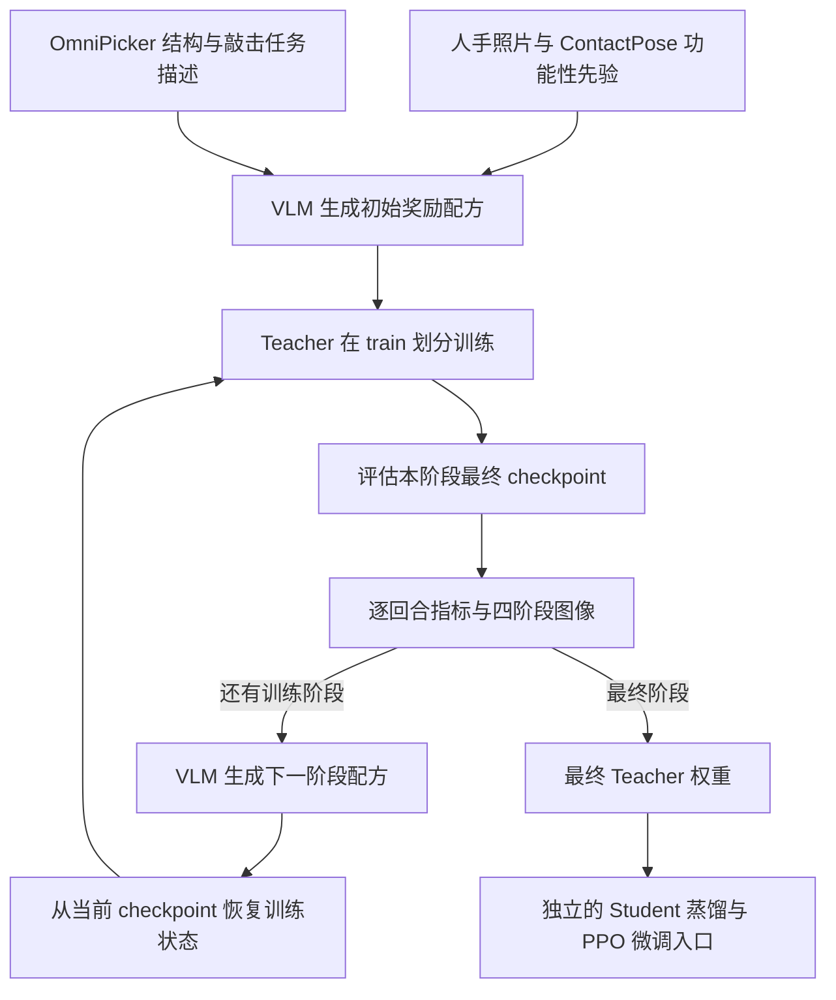

# 人类示范引导的动态任务导向抓取姿态生成框架

**Human-Guided Reward Generation for Dynamic Task-Oriented Grasp Learning**

## 一、研究目标

将人手抓持工具时的接触位置、包覆和掌侧承托转化为欠驱动夹爪可学习的奖励，再用仿真中的实际抓取和敲击结果修正奖励。项目当前实现锤击任务。OmniPicker 在每个回合做一次抓姿决策，随后执行预设的抓取、搬运、三次挥击、两次恢复和最终卸载。完整任务成功要求三次均有效命中，且最终卸载结束、开始撤离前仍有效持锤。

研究重点是初始抓姿对动态持有、滑移、敲击力和恢复的影响。工具在抬升结束时的位姿用于计算后续固定执行轨迹，PPO 优化候选抓姿的局部残差。

## 二、整体技术框架



每个训练阶段使用一份固定配方。V1 从头训练，V2 及以后从上一阶段最终 checkpoint 续训，继承 actor、critic、优化器和 SGS 场景采样状态。VLM 每次根据当前阶段反馈生成一份配方，供下一阶段直接使用。最后一阶段训练完成后只执行评估。

## 三、核心方法

### 3.1 人手功能先验与机器人适配

初始生成读取用户提供的人手抓锤照片、动态任务描述和 `mapping.json`。映射由已有的 ContactPose 锤击记录和 OmniPicker 模型生成。

| `mapping.json` 字段 | 内容 |
| --- | --- |
| `hand_grasp` | 工具坐标系中的人手关键点、骨架连接、接近和对向关系。 |
| `contact_prior` | 原始沿柄接触中心、宽度与区间，以及接触热点和角度覆盖。 |
| `gripper` | 欠驱动二指结构、接触部位、接触 Site、被动弹簧及耦合约束。 |
| `mapped_grasp` | 机器人沿柄抓取区域、闭合方向和两种开爪参考位姿及关键点对应。 |
| `task_context` | 原始记录中的工具工作端和主要载荷类型。 |

映射以锤柄中点为工具坐标系原点，将原始沿柄坐标 `u` 转换为 `u_RL = 2u - 1`，同时将标准差乘 2。V1 用 `mapped_grasp` 初始化配方中的 `mapping_prior`。后续反思可调整机器人适配的区域中心 `u_mean_RL`、宽度 `u_sigma_RL` 和闭合轴 `closing_axis_O`，原始人手 `contact_prior` 始终作为示范依据。 [映射导出](../mapping/export_mapping.py) · [坐标与姿态映射](../mapping/mapping_encoder.py) · [夹爪结构读取](../mapping/omnipicker_adapter.py)

### 3.2 VLM 配方生成与反馈修正

初始 VLM 请求返回奖励项、设计理由及开爪预览下标。`reward_designer` 保存 `reward_v1.json` 和 `grasp_preview.png`。预览中的两个参考位姿用于查看人手与夹爪关键点的对应关系，训练的初始抓姿来自场景缓存中的 AnyGrasp 候选。 [初始生成入口](../vlm_reward/reward_designer.py) · [初始提示词](../vlm_reward/prompts/reward_design.md)

所有阶段使用 V2.0 JSON 配方。每个奖励项由 `id`、`weight`、`formula`、`params` 和 `gate` 描述。VLM 在已有的物理指标和六种公式内选择奖励项，可调整权重、公式、参数及机器人适配先验。执行器把每项的公式结果乘以权重和门控值，再求和。`task_success` 是主要终局目标，`drop` 用负权重，先验公式以有效抬升门控，敲击力奖励以挥击前有效持有门控。 [配方 Schema](../vlm_reward/reward_schema.py) · [公式与统计口径](TRAINING_METRICS.md)

每次反思同时读取原始人手照片和映射、当前完整配方及理由、评估指标的均值、中位数和 p90，以及带索引的代表性关键帧。接触、包络和承托用于判断抓取是否形成。沿柄位置、对向轴和相对位姿漂移用于判断仿生先验与夹爪实际抓持是否吻合。各次敲击力、有效命中、掉落和恢复用于判断动态任务表现。反思结果写为下一阶段 JSON 配方，生成记录包含模型、响应 ID、父配方 ID、反馈目录和生成理由。 [反思提示词](../vlm_reward/prompts/reward_reflection.md) · [闭环调度器](../vlm_reward/reward_evolution.py)

### 3.3 AnyGrasp 引导的 RL Teacher

场景准备阶段缓存初始物理状态、深度图和 AnyGrasp 候选。训练时 SGS 根据各场景最近的 `task_success` 历史分配场景采样概率，reset 再从选中场景的缓存候选中均匀抽取一个。Teacher 使用 87 维 `privileged` 观测，actor 针对该候选输出一次 6 维局部残差。平移按 `tanh` 后的分量乘 `0.10 m`，旋转按 `tanh` 后的轴角分量乘 `π/5 rad`，再与候选基座位姿合成。 [重置与观测](../hammer_rl/mdp/resets.py) · [残差合成与敲击轨迹](../hammer_rl/mdp/actions.py) · [SGS](../hammer_rl/mdp/curriculum.py)

阶段结束后，当前 critic 为 `eval` 划分中每个场景的全部候选评分。Actor 用确定性均值修正最高分候选，仿真执行一次完整尝试，保存指标与回放帧。配方切换发生在两段独立的训练调用之间，续训使用 `--resume`、`--reward-recipe-override` 和本阶段的 `--log-dir`。 [候选推理](../hammer_rl/inference.py) · [训练入口](../hammer_rl/train.py) · [评估入口](../hammer_rl/evaluate.py)

### 3.4 Student 策略蒸馏与推理

Teacher 奖励进化后，可单独执行 `hammer_rl.train --stage distill`，固定教师并用均值动作的 MSE 蒸馏学生。学生接收 `(1, 120, 160)` 深度图和 50 维 `public_seed`，使用 CNN 与 MLP 输出候选局部残差。`--stage student` 可从蒸馏权重初始化学生 actor 并继续 PPO 微调。 [网络与算法配置](../hammer_rl/rl_cfg.py) · [训练入口](../hammer_rl/train.py)

当前在线抓姿入口 `select_grasp()` 接收单视角深度、公开场景字段和世界坐标系中的抓取候选。学生 critic 从候选中打分选择，actor 给出 6D 残差，合成执行位姿并返回预抓位置和开爪控制量。部署前可用 `calibrate.py` 在固定 actor 后校准 critic。 [在线推理](../hammer_rl/inference.py) · [critic 校准](../hammer_rl/calibrate.py)

## 四、运行与产物

从项目根目录运行。使用 `hammer` 环境，预先设置可接收图像和 JSON Schema 输出的 Responses API 服务地址 `OPENAI_BASE_URL` 与密钥 `OPENAI_API_KEY`。默认模型由 YAML 配置指定。将 `--hand-image` 替换为实际的人手抓锤照片。 [VLM 配置](../vlm_reward/configs/vlm.yaml)

```bash
conda activate hammer
export MUJOCO_GL=osmesa
export MPLBACKEND=Agg

output_dir="weight/hammer_rl/runs/teacher/vlm_$(date +%Y%m%d_%H%M%S)"
python -m vlm_reward.reward_designer \
  --hand-image /path/to/hand-hammer.png \
  --data-file weight/hammer_rl/reset_bank_v1_256.npz \
  --description "保持三次有效命中及卸载前持有，提高各次敲击平均力" \
  --output-dir "$output_dir" \
  --evolution-rounds 1 \
  --max-iterations 5000
```

生成预览后输入 `yes` 开始训练。`--evolution-rounds` 表示 V1 之后的修正次数，默认 1，总训练阶段数为 `1 + evolution_rounds`。`--max-iterations` 是每个阶段追加的 PPO 更新数。设 `--evolution-rounds 0` 时执行 V1 训练和评估。

| 产物 | 用途 |
| --- | --- |
| `mapping.json`、`grasp_preview.png` | 保存原始先验、机器人映射和初始关键点对照。 |
| `reward_vN.json` | 保存第 N 阶段实际使用的配方。 |
| `teacher_vN/run_config.json`、`teacher_vN/model_<iteration>.pt` | 保存本阶段配置与训练权重。训练入口的 `checkpoint:` 行给出交接用的最终权重。 |
| `feedback_vN/metrics.npz`、`feedback_vN/frames/index.json` 与关键帧 | 保存本阶段完整反馈评估及闭合、抬升、挥击前、挥击结束的代表性图像。 |

PPO 使用 reset bank 的 `train` 划分，闭环评估使用同一 bank 的 `eval` 划分。因为 `eval` 参与奖励修正，最终独立测试使用 `hammer_rl.prepare --test-set` 生成的另一份缓存。锤击实验可在不同锤柄尺寸和初态下分析完整成功率与各次敲击力度。清扫和单视角点云直接生成抓姿属于后续研究方向。 [场景准备](../hammer_rl/prepare.py) · [训练和评估指标](TRAINING_METRICS.md)
