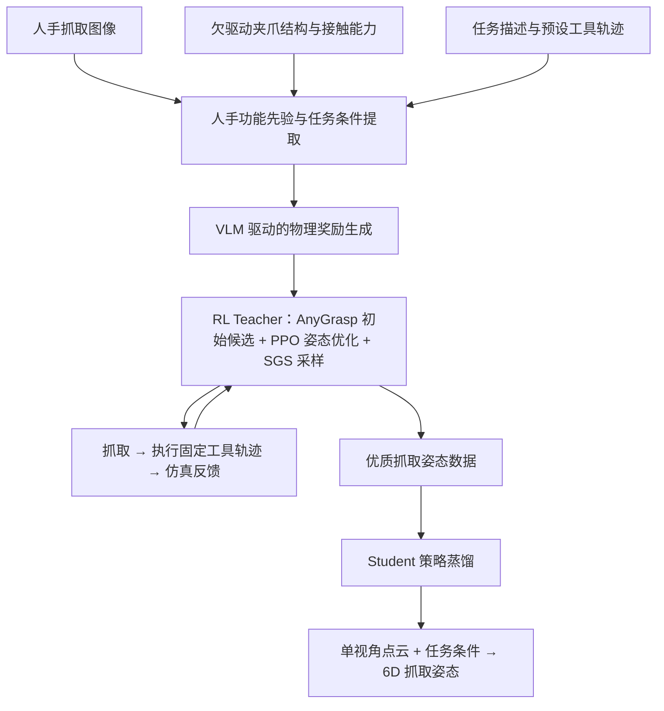

# 人类示范引导的动态任务导向抓取姿态生成框架

**Human-Guided Reward Generation for Dynamic Task-Oriented Grasp Learning**

## 一、研究目标

面向锤击、清扫等高动态工具操作任务，提出一种结合**人手功能性接触先验、VLM 自动奖励生成和强化学习**的抓取姿态生成框架。

通过人手抓取示范及任务描述自动构建符合欠驱动夹爪特性的物理奖励，利用强化学习优化动态任务中的抓取姿态，最终实现从**单视角物体点云到 6D 抓取姿态**的直接生成。

研究范围限定为抓取姿态优化，不学习下游任务执行轨迹。

## 二、整体技术框架

整个方法分为四个阶段：

1. **人手先验与任务条件提取**：从人手示范、夹爪模型、任务描述和固定轨迹中提取结构化信息。
2. **VLM 驱动的物理奖励生成**：将功能性接触关系及任务目标转化为可执行的仿真奖励。
3. **强化学习 Teacher 训练**：基于 AnyGrasp 候选进行单步抓取姿态优化，通过完整任务执行获取奖励。
4. **Student 策略蒸馏**：学习从单视角点云及任务条件到 6D 抓取姿态的映射，实现新工具几何下的快速推理。

## 三、核心方法

### 3.1 人手功能先验与任务条件构建

**输入：**

- **人手抓取图像**：提取手部关节、抓取姿态及潜在接触区域。
- **欠驱动夹爪模型**：提供夹爪几何、关节耦合关系及接触能力。
- **任务描述**：定义锤击冲击效果、清扫稳定性等目标。
- **预设任务轨迹**：提供工具运动方向、速度变化及接触阶段信息。

**方法：**

参考 GAT-Grasp 的人手姿态映射思想，建立人手接触关系到欠驱动夹爪可实现接触模式的转换，形成结构化接触先验。

### 3.2 VLM 驱动的任务奖励生成

将人手接触先验、夹爪结构及任务条件输入 VLM，生成适用于机器人仿真的物理奖励定义。

奖励划分为两类：

$$
R = w_c R_{\mathrm{contact}} + w_t R_{\mathrm{task}}
$$

| 奖励类型 | 主要内容 |
| --- | --- |
| 功能性接触奖励 | 接触位置、包络关系、接触方向、抗滑移和抗旋转能力 |
| 任务效果奖励 | 锤击冲量与稳定性、清扫效果与执行稳定性 |

VLM 负责选择奖励指标、定义计算关系及初始权重；仿真模块提供实际接触状态和任务反馈，并执行奖励计算。

### 3.3 AnyGrasp 引导的 RL Teacher

采用**单步姿态决策 + 完整任务执行反馈**的强化学习结构。

**Teacher 训练流程：**

1. 输入随机化工具点云及任务条件，通过 AnyGrasp 生成初始抓取候选。
2. 结合人手先验筛选初始姿态。
3. PPO Actor 输出 6D 姿态残差，优化抓取位置与方向。
4. 机器人抓取工具，并执行预设任务轨迹。
5. 根据 VLM 构建的奖励函数评估任务效果，更新策略。

姿态优化形式：

$$
T_g = T_0\exp(\hat{\xi}_{\theta})
$$

其中，$T_0$ 是初始抓取姿态，$\xi_{\theta}\in\mathbb{R}^{6}$ 是策略输出的姿态修正量。

训练中使用 SGS 调整不同几何及难度场景的采样分布，获得覆盖多种工具把手的高质量抓取策略。

### 3.4 Student 策略蒸馏与泛化生成

利用 Teacher 在随机几何场景下优化得到的抓取姿态构建训练数据：

$$
\mathcal{D}=\{(P_i,z_i,T_{g,i}^{*})\}_{i=1}^{N}
$$

其中，$P_i$ 为单视角点云，$z_i$ 为任务条件，$T_{g,i}^{*}$ 为 Teacher 优化后的优质抓取姿态。

Student 采用点云编码器与抓取姿态预测网络：

$$
\boxed{\pi_S(P,z_{\mathrm{task}})\rightarrow T_g\in SE(3)}
$$

直接生成 6D 抓取姿态，不依赖在线强化学习或任务轨迹优化。

**备选方案：**保留 AnyGrasp 作为 Student 的初始候选生成器，再预测 6D 姿态残差。

## 四、任务与泛化设置

| 任务 | 优化目标 | 泛化对象 |
| --- | --- | --- |
| 锤击 | 冲击传递效果、方向稳定性、抗滑移 | 不同形状、长度、截面的锤柄 |
| 清扫 | 持续接触效果、动态稳定性、抗滑移 | 不同形状、尺寸的清扫工具把手 |

工具任务轨迹预先设定，训练策略只优化抓取姿态。不同抓取姿态对应的机械臂末端轨迹通过工具与末端之间的位姿变换计算，使工具遵循相同的目标运动轨迹。

几何随机化主要覆盖工具把手的截面形状、尺寸、长度及初始空间姿态。

## 五、整体研究贡献定位

**贡献一：人手功能性接触引导的任务奖励自动生成。**

构建人手抓取示范、欠驱动夹爪接触能力及动态任务条件之间的映射机制，利用 VLM 生成具有物理意义的接触约束与任务奖励。

**贡献二：先验引导的强化学习与抓取策略蒸馏。**

通过 AnyGrasp 初始化的 RL Teacher 学习固定动态任务轨迹下的有效抓取姿态，并将其蒸馏到单视角点云 Student 网络，实现不同工具几何条件下的 6D 抓取姿态直接生成。

**总体技术链：**

> 人类抓取示范与任务意图 → 机器人功能性接触奖励 → 物理交互驱动的 Teacher 优化 → Student 泛化抓取姿态生成。
